# 03 — Modèle de domaine

| | |
|---|---|
| **Statut** | Brouillon v0.2 (ligne paternelle, P1, P11, P12, CHK-07 intégrés) |
| **Dépend de** | 01-cadrage, 02-regles-metier (v0.3) |
| **Alimente** | 04-architecture (choix techniques), 05-securite-confidentialite, 06-api |

> Ce document décrit le **modèle conceptuel** (entités, attributs, relations, contraintes). Les types SQL exacts, index et migrations viendront avec l'implémentation.
> Légende : ✅ découle d'une règle validée · 🟡 choix de conception proposé · ❓ dépend d'un point ouvert du doc 02.

---

## 1. Principes de modélisation

1. **Personne ≠ compte.** `PERSON` décrit un individu de l'arbre ; `ACCOUNT` décrit un accès à la plateforme. Un lien optionnel 1–1 les relie (RG-ENT-01/02).
2. **Le graphe est explicite.** Les relations sont des tables de liens : `PARENT_LINK` (filiation) et `PERSON_UNION` (union). Aucune relation n'est déduite d'un champ de la personne.
3. **Filiation par parent, pas par union** (RG-ENT-05). Un enfant a donc ses liens propres, ce qui gère naturellement demi-fratries, adoptions et recompositions.
4. **Deux structures d'historique séparées** (RG-MOD-05) : la file `PENDING_CHANGE` (temporaire, propositions) et l'historique définitif `FIELD_HISTORY` + `CHANGE_LOG` (seulement l'approuvé ou le direct).
5. **Le RBAC est de la donnée** (RG-ROL-01) : rôles, permissions et attributions sont des tables, pas des constantes dans le code. Les règles culturelles sont des **politiques configurables** (RG-ROL-07).
6. **La visibilité est calculée côté serveur** à partir de données, jamais déduite par l'interface (RG-VIS-09).

## 2. Diagramme entité-relation

```mermaid
erDiagram
    PERSON ||--o| ACCOUNT : "lié à (optionnel)"
    PERSON ||--o{ PARENT_LINK : "est parent"
    PERSON ||--o{ PARENT_LINK : "est enfant"
    PERSON ||--o{ PERSON_UNION : "partenaire A"
    PERSON ||--o{ PERSON_UNION : "partenaire B"
    PERSON ||--o{ PERSON_VISIBILITY : "a"
    PERSON ||--o{ DOCUMENT : "possède"
    PERSON_UNION ||--o{ DOCUMENT : "possède"
    DOCUMENT }o--|| STORED_FILE : "référence"
    PERSON }o--o| STORED_FILE : "photo"
    PERSON ||--o{ PERSON_CLOSURE : "ancêtre"
    PERSON ||--o{ PERSON_CLOSURE : "descendant"

    BRANCH }o--|| PERSON : "fondateur"
    BRANCH ||--o{ HOUSE : "contient"
    HOUSE }o--|| PERSON_UNION : "maison de"

    ACCOUNT ||--o{ ROLE_ASSIGNMENT : "reçoit"
    ROLE ||--o{ ROLE_ASSIGNMENT : "attribué via"
    ROLE ||--o{ ROLE_PERMISSION : "contient"
    PERMISSION ||--o{ ROLE_PERMISSION : "accordée par"
    ROLE ||--o{ ROLE_POLICY : "régi par"

    ACCOUNT ||--o{ PENDING_CHANGE : "propose"
    ACCOUNT ||--o{ INVITATION : "envoie"
    ACCOUNT ||--o{ NOTIFICATION : "reçoit"
    PENDING_CHANGE ||--o{ NOTIFICATION : "déclenche"
    PENDING_CHANGE ||--o{ FIELD_HISTORY : "produit si approuvé"
    PENDING_CHANGE ||--o| CHANGE_LOG : "produit si approuvé"
    ACCOUNT ||--o{ FIELD_HISTORY : "auteur"
    ACCOUNT ||--o{ CHANGE_LOG : "auteur"

    PERSON {
        uuid id PK
        string first_names
        string last_name
        string sex
        string life_status
        date birth_date
        string birth_date_precision
        string birth_place
        date death_date
        string death_date_precision
        string death_place
        uuid photo_file_id FK
        int row_version
        bool is_deleted
    }
    ACCOUNT {
        uuid id PK
        string email
        string password_hash
        string status
        uuid person_id FK
        uuid approved_by FK
        datetime approved_at
    }
    PERSON_UNION {
        uuid id PK
        uuid person_a_id FK
        uuid person_b_id FK
        string status
        date start_date
        date end_date
        string place
        int row_version
    }
    PARENT_LINK {
        uuid id PK
        uuid parent_id FK
        uuid child_id FK
        string kind
        date adoption_date
        int row_version
    }
    PERSON_VISIBILITY {
        uuid person_id FK
        string category
        string level
    }
    PERSON_CLOSURE {
        uuid ancestor_id FK
        uuid descendant_id FK
        string path_type
        int depth
    }
    DOCUMENT {
        uuid id PK
        uuid person_id FK
        uuid union_id FK
        string doc_type
        uuid file_id FK
        string visibility_level
    }
    STORED_FILE {
        uuid id PK
        string storage_key
        string mime_type
        int size_bytes
        string sha256
    }
    BRANCH {
        uuid id PK
        string name
        uuid founder_person_id FK
        uuid parent_branch_id FK
    }
    HOUSE {
        uuid id PK
        uuid branch_id FK
        uuid union_id FK
        string name
    }
    ROLE {
        uuid id PK
        string code
        string label
        bool is_system
    }
    PERMISSION {
        string code PK
        string description
    }
    ROLE_PERMISSION {
        uuid role_id FK
        string permission_code FK
    }
    ROLE_ASSIGNMENT {
        uuid id PK
        uuid account_id FK
        uuid role_id FK
        string scope_type
        uuid scope_id
        bool is_provisional
        uuid assigned_by FK
        datetime assigned_at
        datetime revoked_at
    }
    ROLE_POLICY {
        uuid id PK
        uuid role_id FK
        string policy_key
        json params
    }
    PENDING_CHANGE {
        uuid id PK
        uuid author_account_id FK
        string target_type
        uuid target_id
        string operation
        json payload
        int base_row_version
        string status
        uuid decided_by FK
        datetime decided_at
        string decision_reason
    }
    FIELD_HISTORY {
        uuid id PK
        string entity_type
        uuid entity_id
        string field_name
        json old_value
        json new_value
        string data_category
        string source
        uuid changed_by FK
        datetime changed_at
        uuid pending_change_id FK
    }
    CHANGE_LOG {
        uuid id PK
        string event_type
        string entity_type
        uuid entity_id
        json details
        string source
        uuid actor_account_id FK
        datetime occurred_at
        uuid pending_change_id FK
    }
    INVITATION {
        uuid id PK
        string token_hash
        string email
        uuid invited_by FK
        uuid target_person_id FK
        datetime expires_at
        datetime accepted_at
    }
    NOTIFICATION {
        uuid id PK
        uuid recipient_account_id FK
        string type
        uuid pending_change_id FK
        datetime created_at
        datetime read_at
    }
```



## 3. Entités

### 3.1 Cœur généalogique

**PERSON** ✅ RG-ENT-01/02/07/08
- `sex` : valeurs `M` / `F`. Nécessaire aux règles du chef de famille (RG-FAM-03) et de la fille aînée (RG-FAM-04).
- `life_status` : `living` / `deceased` / `unknown` ✅ (P11). Distinct de `death_date` : un ancêtre peut être décédé sans date connue. `unknown` est traité comme `living` pour la visibilité (prudence).
- Dates généalogiques avec **précision** (`year` / `month` / `day`) 🟡 : on connaît souvent seulement l'année. `birth_date_precision` pilote l'affichage et la règle de visibilité (RG-VIS-04 : année seule au public).
- `photo_file_id` : une seule photo (RG-ENT-08).
- `row_version` : verrouillage optimiste, nécessaire pour détecter les conflits de modération (RG-MOD-11).
- `is_deleted` : suppression logique ; l'historique et les liens restent consultables par l'admin.
- Aucun `branch_id` stocké : l'appartenance à une branche est **calculée** via `PERSON_CLOSURE` (chemins `paternal`) ✅ RG-ENT-12.

**PERSON_UNION** ✅ RG-ENT-03/04
- Exactement deux partenaires : `person_a_id` et `person_b_id`, avec `person_a_id <> person_b_id`.
- `status` : valeurs proposées `married`, `partnered`, `separated`, `divorced`, `widowed` 🟡. Liste fermée à confirmer.
- La polygamie n'ajoute aucun champ : plusieurs lignes partagent une personne.
- Nommée `PERSON_UNION` car `UNION` est un mot réservé SQL.

**PARENT_LINK** ✅ RG-ENT-05/06
- `kind` : `biological` ou `adoptive`. Donnée structurelle, utilisée aussi par le rendu (trait plein ou pointillé, par exemple).
- `adoption_date` optionnelle (non nulle seulement si `kind = adoptive`).
- Un enfant peut avoir plusieurs parents de chaque type (adoption plénière, famille recomposée).

**PERSON_CLOSURE** 🟡 ❓ P7, P13
- Table de **fermeture transitive** de la filiation : une ligne par couple (ancêtre, descendant) **et par type de chemin**, avec `depth` = longueur du chemin le plus court en générations.
- `path_type` :
  - `all` : chemins tous liens confondus ;
  - `biological` : chemins composés uniquement de liens biologiques ;
  - `paternal` : chemins composés uniquement de liens **père → enfant** (le parent est un homme). Sert à calculer les branches (RG-ENT-12). Selon P13, les liens adoptifs père → enfant y sont inclus.
- Clé primaire : (`ancestor_id`, `descendant_id`, `path_type`).
- Les filtres « N générations en amont ou aval », avec ou sans adoption, et le scope « lignée directe » se résolvent par une simple jointure, **sans** parcours récursif à chaque requête.
- Maintenue par le service applicatif (ou trigger) à chaque création ou suppression de `PARENT_LINK` approuvé, dans la même transaction. Si le `sex` d'un parent change, les chemins `paternal` concernés sont recalculés.
- Voir 6.1 pour le choix closure table vs `ltree`.

### 3.2 Contenu

**DOCUMENT** ✅ RG-ENT-09
- Rattaché soit à une `PERSON`, soit à une `PERSON_UNION` (ex. acte de mariage) : exactement l'un des deux (`CHECK`).
- `doc_type` : `birth_certificate`, `marriage_certificate`, `death_certificate`, `other` 🟡.
- Pas de métadonnées extraites : date, lieu et témoins viennent de la saisie de la personne ou de l'union.
- Les documents ne sont **jamais publics** (RG-VIS-04) ; `visibility_level` est borné au plus à `approved`.

**STORED_FILE** 🟡 : métadonnées du fichier binaire (clé de stockage objet, type MIME, taille, empreinte). Le binaire est hors base (voir doc 04).

### 3.3 Visibilité

**PERSON_VISIBILITY** ✅ (P1)
- Une ligne par (personne, catégorie) avec `category` ∈ {`general`, `details`, `media`} et `level` ∈ {`public`, `members_only`, `approved`, `private`} ✅ RG-VIS-01.
- Seul l'admin modifie `level` (RG-MOD-07, RG-VIS-06).
- **Visibilité effective** = niveau le plus restrictif entre `PERSON_VISIBILITY` et les plafonds automatiques (voir 5.2).

### 3.4 Comptes et accès

**ACCOUNT** ✅ RG-ACC-01/02/03
- `status` : `invited` → `pending_approval` → `approved`, ou `suspended` 🟡 ❓ P9.
- `person_id` : unique, nullable. La **revendication** est l'action admin qui renseigne ce champ.
- L'authentification elle-même (mot de passe, OAuth…) relève du doc 04.

**INVITATION** ✅ RG-ACC-01 : jeton (haché), email, auteur, personne cible optionnelle (profil à revendiquer), expiration, date d'acceptation.

### 3.5 Branches et maisons

**BRANCH** ✅ RG-FAM-01..06
- Définie par une **personne fondatrice**. Son périmètre (la « lignée directe ») = fondateur + descendants par chemin `paternal`, calculé via `PERSON_CLOSURE` ✅ RG-ENT-12. Les filles sont membres de la branche de leur père ; l'épouse **par alliance** n'est pas membre de la branche de son mari.
- `parent_branch_id` permet d'emboîter les branches (clan → famille → lignée) sans limite de profondeur (RG-ENT-07).

**HOUSE** ✅ RG-FAM-06 : « maison » rattachée à une union polygame (celle d'une épouse) au sein d'une branche.

**Branche de naissance d'une personne** : la branche la plus proche contenant la personne (fondateur le plus récent sur sa ligne paternelle). Utilisée pour l'éligibilité de l'épouse successeure (RG-FAM-05).

### 3.6 RBAC

**ROLE** ✅ RG-ROL-01/03 : `code` stable (`contributor`, `moderator`, `branch_editor`, `coeditor`, `admin`, `co_admin`), `is_system` pour les rôles fournis par défaut (non supprimables).

**PERMISSION** : liste fermée de permissions atomiques (voir 4).

**ROLE_ASSIGNMENT** ✅ RG-ROL-02
- Attribution **scopée** : `scope_type` ∈ {`global`, `branch`, `house`} et `scope_id` (nul pour `global`).
- `is_provisional` 🟡 : vrai pour les attributions automatiques (épouse, fille aînée, RG-FAM-07) jusqu'à désignation par l'admin. Le rôle `coeditor` couvre à la fois le co-éditeur de maison (scope `house`) et la co-éditrice successeure (scope `branch`).
- `revoked_at` : on ne supprime pas, on révoque (traçabilité).

**ROLE_POLICY** 🟡 RG-ROL-07 : paramètres configurables rattachés à un rôle, par exemple :
- `required_sex = M` pour `branch_editor` (RG-FAM-03) ;
- `succession_order = [first_spouse, eldest_daughter, admin_appoints]` (RG-FAM-07) ;
- `succession_provisional = true`.

### 3.7 Modération et historique

**PENDING_CHANGE** ✅ RG-MOD-01..05, 08, 10..12
- `target_type` / `target_id` : cible de la modification (`person`, `union`, `parent_link`, `document`…). `target_id` nul pour une création.
- `operation` : `create` / `update` / `delete`.
- `payload` : valeurs proposées (JSON), au niveau du champ pour un `update`.
- `base_row_version` : version de la cible lue par l'auteur ; si elle diffère à la décision, conflit à trancher par l'admin (RG-MOD-11).
- `status` : `pending`, `approved`, `rejected`, `withdrawn` ; **jamais supprimé** (RG-MOD-04). `decision_reason` obligatoire pour `rejected`.

**FIELD_HISTORY** ✅ RG-HIS-01 : une ligne par champ changé, avec ancienne et nouvelle valeur, auteur, date, `source` (`direct` ou `moderated`) et lien éventuel vers le `PENDING_CHANGE` d'origine. `data_category` permet d'appliquer la visibilité à l'historique (RG-HIS-04).

**CHANGE_LOG** ✅ RG-HIS-02 : événement général (`union_created`, `document_added`, `parent_link_created`, `person_merged`, `visibility_changed`…) avec détails JSON.

**NOTIFICATION** ✅ RG-NOT-01 : MVP limité aux notifications de modération (un `PENDING_CHANGE` crée une ligne par destinataire : admin, co-admins, modérateurs concernés).

---

## 4. Permissions et rôles initiaux

### 4.1 Permissions atomiques 🟡

| Code | Rôle de la permission |
|---|---|
| `person.read` | Lire un profil (soumis à la visibilité effective) |
| `person.search` | Rechercher par nom |
| `tree.generate` | Générer un arbre personnalisé |
| `history.read` | Consulter l'historique |
| `change.propose` | Proposer une modification (crée un `PENDING_CHANGE`) |
| `change.edit_direct` | Modifier directement, sans modération (RG-MOD-00) |
| `change.moderate` | Approuver ou rejeter des propositions |
| `invitation.send` | Inviter une personne |
| `account.approve` | Approuver un compte |
| `account.claim` | Revendiquer un profil |
| `role.assign` | Attribuer ou révoquer un rôle |
| `visibility.manage` | Modifier la visibilité d'un profil |
| `person.merge` | Fusionner des doublons |
| `conflict.resolve` | Trancher un conflit |

### 4.2 Matrice rôles × permissions (seed)

| Permission | Contributeur | Co-éditeur(trice) | Éditeur branche | Modérateur | Admin / Co-admin |
|---|:-:|:-:|:-:|:-:|:-:|
| `person.read`, `person.search`, `tree.generate`, `history.read` | ✓ | ✓ | ✓ | ✓ | ✓ |
| `change.propose` | ✓ | ✓ | ✓ | ✓ | ✓ |
| `change.edit_direct` | | ✓ *(maison ou branche)* | ✓ *(branche)* | ✓ *(périmètre)* ❓ P8 | ✓ |
| `change.moderate` | | | | ✓ | ✓ |
| `invitation.send` | | ✗ ❓ P14 | ✓ *(branche)* | | ✓ |
| `account.approve`, `account.claim`, `role.assign` | | | | | ✓ |
| `visibility.manage`, `person.merge`, `conflict.resolve` | | | | | ✓ |

> Un rôle n'agit que **dans son scope** : `change.edit_direct` d'un éditeur de branche ne vaut que sur les personnes de cette branche. Hors scope, seule `change.propose` s'applique (RG-MOD-09).

---

## 5. Règles de calcul clés

### 5.1 Décision d'une modification (direct ou modéré) ✅ RG-MOD-00/01/09

```
fonction soumettre(account, cible, operation, payload):
    si permission(account, "change.edit_direct", cible):
        transaction:
            appliquer(cible, payload)              # incrémente row_version
            écrire FIELD_HISTORY (source = direct)
            écrire CHANGE_LOG    (source = direct)
        retourner APPLIQUÉ
    sinon si permission(account, "change.propose", cible):
        créer PENDING_CHANGE (base_row_version = cible.row_version)
        notifier admin + modérateurs concernés
        retourner EN_ATTENTE
    sinon:
        retourner INTERDIT
```

`permission(account, p, cible)` : vrai s'il existe une attribution **non révoquée** dont le rôle contient `p` et dont le scope **couvre** la cible (global, ou branche contenant la personne via `PERSON_CLOSURE`, ou maison).

### 5.2 Visibilité effective ✅ RG-VIS-04/05/07 🟡

```
fonction visibilité_effective(personne, catégorie, demandeur):
    niveau  = PERSON_VISIBILITY[personne, catégorie]        # défaut : approved
    plafond = plafond_automatique(personne, catégorie)
    niveau_effectif = le plus restrictif entre niveau et plafond
    retourner demandeur.niveau_accès ≥ niveau_effectif

plafond_automatique:
    catégorie media      → au plus "approved"         (jamais public)
    catégorie details    → si life_status ≠ deceased : "approved"
    catégorie general    → champs publics limités à : noms, prénoms,
                           parenté, année de naissance/décès
```

Niveaux d'accès du demandeur : `lecteur public` < `connecté non approuvé` < `connecté approuvé` < `admin`.

### 5.3 Approbation d'une proposition ✅ RG-MOD-10/11

```
fonction approuver(décideur, pending):
    exiger permission(décideur, "change.moderate", pending.cible)
    transaction:
        si cible.row_version ≠ pending.base_row_version:
            marquer CONFLIT ; exiger "conflict.resolve" ; arrêter
        appliquer(cible, pending.payload)
        écrire FIELD_HISTORY (source = moderated, pending_change_id)
        écrire CHANGE_LOG
        pending.status = approved
```

---

## 6. Décisions de conception à porter dans le doc 04

### 6.1 Closure table plutôt que `ltree` pour la filiation 🟡
`ltree` modélise un **arbre** : chaque nœud a un seul chemin vers la racine. Or une personne a **deux parents** : la généalogie est un **graphe orienté acyclique (DAG)**. Une closure table gère plusieurs chemins par couple. `ltree` reste envisageable **uniquement pour les branches** (`BRANCH`), qui forment réellement un arbre.

### 6.2 Contraintes d'intégrité à faire respecter 🟡

| Réf. | Contrainte | Mécanisme |
|---|---|---|
| CHK-01 | Une personne n'est pas son propre parent ; le graphe de filiation reste acyclique (RG-ENT-10). | Vérification applicative avant insertion, via `PERSON_CLOSURE`. |
| CHK-02 | Une union relie deux personnes distinctes. | `CHECK (person_a_id <> person_b_id)`. |
| CHK-03 | Une même paire parent→enfant n'existe qu'une fois. | Contrainte d'unicité. |
| CHK-04 | `adoption_date` seulement pour `kind = adoptive`. | `CHECK`. |
| CHK-05 | Un `DOCUMENT` référence soit une personne, soit une union. | `CHECK` à exclusivité. |
| CHK-06 | On ne peut pas retirer le dernier admin ou co-admin (RG-CON-02). | Garde applicative dans le service de rôles. |
| CHK-07 ✅ | Au plus deux parents biologiques par enfant (RG-ENT-11). | Vérification applicative à l'insertion d'un `PARENT_LINK` biologique. |

### 6.3 Rôles automatiques (succession)
La succession (RG-FAM-07) est un **calcul**, pas un rôle codé en dur : un service évalue, par branche, la politique `succession_order` et crée une `ROLE_ASSIGNMENT` avec `is_provisional = true`. Cet ordre est : **première épouse éligible** (union la plus ancienne, `PERSON_UNION.start_date`) dont la branche de naissance est la branche concernée, avec le rôle `coeditor` ; sinon la fille aînée (ordre déterminé par `birth_date`) ; sinon désignation par l'admin. Si les dates sont absentes ou égales, l'admin départage.

---

## 7. Traçabilité règles → modèle

| Règle | Éléments du modèle |
|---|---|
| RG-ENT-01/02 | `PERSON`, `ACCOUNT`, `ACCOUNT.person_id` nullable |
| RG-ENT-03/04 | `PERSON_UNION` (+ `status`), plusieurs lignes par personne |
| RG-ENT-05/06 | `PARENT_LINK` (+ `kind`) |
| RG-ENT-07, RG-ENT-11, RG-ENT-12 | `PERSON_CLOSURE` (chemins `paternal`), `BRANCH.parent_branch_id`, CHK-07 |
| RG-ENT-08/09 | `PERSON.photo_file_id`, `DOCUMENT`, `STORED_FILE` |
| RG-VIS-01..09 | `PERSON_VISIBILITY`, fonction de visibilité effective, `DOCUMENT.visibility_level` |
| RG-ROL-01..07 | `ROLE`, `PERMISSION`, `ROLE_PERMISSION`, `ROLE_ASSIGNMENT`, `ROLE_POLICY` |
| RG-FAM-01..07 | `BRANCH`, `HOUSE`, `ROLE_ASSIGNMENT.is_provisional`, `ROLE_POLICY` |
| RG-MOD-00..13 | `PENDING_CHANGE`, `row_version`, `change.edit_direct` / `change.propose` / `change.moderate` |
| RG-DUP-01..03 | `CHANGE_LOG` (`person_merged`), recherche de similarité (doc 04) |
| RG-HIS-01..04 | `FIELD_HISTORY`, `CHANGE_LOG`, `data_category` |
| RG-ACC-01..03 | `ACCOUNT.status`, `INVITATION`, `account.claim` |
| RG-NOT-01 | `NOTIFICATION` |
| RG-CON-01..03 | `ROLE_ASSIGNMENT` (rôle `co_admin`), CHK-06 |

## 8. Questions restantes ayant un impact sur ce modèle

- **P13** : un enfant adoptif d'un homme de la branche appartient-il à sa branche ? Pilote l'inclusion des liens adoptifs dans les chemins `paternal`.
- **P14** : droits exacts de la co-éditrice successeure (invitations, nomination).
- **P8** : périmètre du modérateur (global ou par branche).
