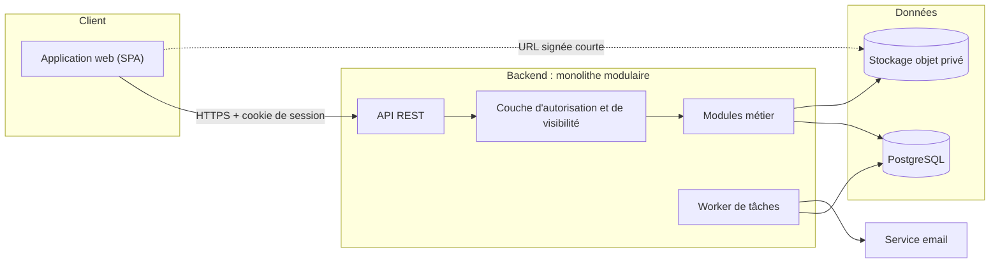

# 04 — Architecture technique et décisions (ADR)

| | |
|---|---|
| **Statut** | Brouillon v0.1 — **stack à valider** |
| **Dépend de** | 01-cadrage, 02-regles-metier (v0.3), 03-modele-domaine (v0.2) |
| **Alimente** | 05-securite-confidentialite, 06-api, 07-plan-livraison |

> Légende : ✅ décision déjà prise · 🟡 proposition à valider.
> Aucun choix de stack n'était arrêté (le `.gitignore` NestJS du dépôt est un template). Les ADR ci-dessous sont des **recommandations argumentées** : chacune peut être contredite, et son impact est indiqué.

---

## 1. Exigences d'architecture

Elles découlent du cadrage et des règles métier.

| # | Exigence | Origine |
|---|---|---|
| EA-01 | **Confidentialité par construction** : aucune donnée non autorisée ne doit sortir de l'API, quelle que soit la surface (arbre, recherche, historique, notifications). | RG-VIS-09, risque R4 |
| EA-02 | **Intégrité et traçabilité** : appliquer un changement et écrire l'historique dans une seule transaction ; historique en ajout seul. | RG-MOD-10, RG-HIS |
| EA-03 | **Permissions scopées et configurables** (RBAC en base, politiques de succession paramétrables). | RG-ROL, RG-FAM |
| EA-04 | **Requêtes de graphe rapides** (générations amont/aval, lignée directe) sur un arbre qui grandit sans limite. | RG-ENT-07, RG-ARB-02 |
| EA-05 | **Exploitation simple** : projet porté par une petite équipe, coût d'hébergement bas, un seul SGBD. | Cadrage, décision ✅ |
| EA-06 | **Volumétrie modeste** : une famille, soit quelques milliers à quelques dizaines de milliers de personnes. Pas de besoin de mise à l'échelle horizontale. | Cadrage |
| EA-07 | **Légèreté côté utilisateur** : pages et photos économes en bande passante (famille dispersée, appareils variés, mobile). | Contexte |
| EA-08 | **Maintenabilité** : code structuré par domaine, règles métier isolées et testables. | Bonnes pratiques |

## 2. Vue d'ensemble



**Idée directrice** : un **monolithe modulaire** (un déploiement, des modules à frontières nettes), **PostgreSQL** pour toutes les données structurées *et* la file de tâches, un **stockage objet privé** pour les binaires, et une **couche d'autorisation unique** par laquelle passent toutes les lectures et écritures.

## 3. Découpage en modules

| Module | Responsabilité | Entités (doc 03) |
|---|---|---|
| `identity-access` | Comptes, authentification, invitations, rôles, permissions, politiques | `ACCOUNT`, `INVITATION`, `ROLE`, `PERMISSION`, `ROLE_PERMISSION`, `ROLE_ASSIGNMENT`, `ROLE_POLICY` |
| `genealogy` | Personnes, unions, filiations, branches, maisons, fermeture transitive, recherche, arbre filtré | `PERSON`, `PERSON_UNION`, `PARENT_LINK`, `PERSON_CLOSURE`, `BRANCH`, `HOUSE` |
| `visibility` | Calcul de la visibilité effective, projections par niveau d'accès | `PERSON_VISIBILITY` |
| `moderation` | Soumission, décision, conflits, application atomique | `PENDING_CHANGE` |
| `history` | Historique de champ et général, en ajout seul | `FIELD_HISTORY`, `CHANGE_LOG` |
| `documents` | Fichiers, photos, pièces jointes | `DOCUMENT`, `STORED_FILE` |
| `notifications` | Notifications de modération, emails | `NOTIFICATION` |

**Règles de dépendance** (à faire respecter par un linter d'architecture, par exemple `dependency-cruiser`) :
- `moderation` dépend de `genealogy`, `history` et `identity-access` ; **jamais l'inverse**.
- Aucun module n'accède aux **tables d'un autre module** : il passe par son service public.
- Les modules communiquent par **appels de service** pour le transactionnel, et par **événements de domaine** pour les effets secondaires (notification après `PENDING_CHANGE` créé).
- `visibility` et `identity-access` sont des dépendances transverses, appelées par tous.

---

## 4. Décisions d'architecture (ADR)

### ADR-001 — Monolithe modulaire 🟡
- **Contexte** : EA-05, EA-06, EA-08. Une seule équipe, un seul arbre, aucune charge extrême.
- **Décision** : un backend unique, découpé en modules (section 3).
- **Alternatives** : microservices (coût d'exploitation, transactions distribuées, aucun gain ici).
- **Conséquences** : les transactions entre modules restent simples (EA-02). Les frontières sont tenues par convention et outillage, pas par le réseau.

### ADR-002 — Backend en TypeScript avec NestJS 🟡 *(stack à valider)*
- **Contexte** : EA-03 et EA-08 demandent des modules, de l'injection de dépendances et des gardes d'accès centralisés.
- **Décision** : **NestJS (TypeScript)**. Ses modules reproduisent le découpage de la section 3, ses *guards* portent les contrôles de permission, ses *providers* facilitent l'application des principes SOLID.
- **Alternatives** : Spring Boot (robuste mais lourd), Django (très productif, bon admin, mais moins typé), Laravel, Fastify seul (trop peu structurant).
- **Conséquences** : un seul langage côté serveur et client (partage des types et des DTO). Compétence JS/TS requise.

### ADR-003 — PostgreSQL comme unique SGBD ✅
- **Contexte** : EA-05. Décision déjà prise : un seul SGBD pour comptes, RBAC, modération, historique et documents.
- **Décision** : **PostgreSQL**. Colonnes `JSONB` pour `payload` et `details`. Extensions : `pg_trgm`, `unaccent`, `fuzzystrmatch` (ADR-008).
- **Filiation** : **closure table** (`PERSON_CLOSURE`, doc 03 §6.1), pas `ltree` : la généalogie est un graphe orienté acyclique, pas un arbre. `ltree` reste réservé aux branches si besoin.
- **Conséquences** : transactions ACID pour le couple « appliquer + historiser » (EA-02). La file de tâches tient dans la même base (ADR-009).

### ADR-004 — Accès aux données : Prisma, avec SQL brut pour le graphe 🟡 *(à valider)*
- **Contexte** : migrations fiables, typage, mais maintenance de `PERSON_CLOSURE` et requêtes récursives qui exigent du SQL.
- **Décision** : **Prisma** (schéma, migrations, client typé) ; les mises à jour de la closure et les requêtes de graphe en **SQL brut paramétré**, encapsulées dans un dépôt `ClosureRepository`.
- **Alternatives** : TypeORM (intégration Nest, entités décorées, mais migrations moins sûres), Drizzle ou Kysely (proches du SQL, moins répandus).
- **Conséquences** : le SQL brut est confiné et testé (ADR-012). Les contraintes `CHECK` du doc 03 §6.2 vont dans des migrations SQL.

### ADR-005 — Frontend : React, TypeScript et Vite en SPA 🟡 *(à valider)*
- **Contexte** : EA-07. L'application est derrière connexion, hors la page publique minimale ; le référencement n'est pas un enjeu.
- **Décision** : **React + TypeScript + Vite** en application monopage. Rendu de l'arbre par une bibliothèque dédiée à adapter (D3 avec `d3-dag`, ou React Flow), **à prototyper tôt** : polygamie, demi-fratries et liens adoptifs sortent des mises en page d'arbre classiques.
- **Alternatives** : Next.js (SSR utile surtout si le public doit être indexé), Vue ou Svelte.
- **Conséquences** : bundle à surveiller (découpage par routes, chargement paresseux de la bibliothèque d'arbre). Mise en page de l'arbre = principal risque UI.

### ADR-006 — API REST documentée en OpenAPI 🟡
- **Contexte** : les DTO diffèrent par niveau d'accès (EA-01) ; l'autorisation est plus simple à raisonner par ressource.
- **Décision** : **REST + OpenAPI** (module Swagger de Nest). Un DTO distinct par niveau d'accès (`PublicPersonDto`, `ApprovedPersonDto`, `AdminPersonDto`).
- **Alternatives** : GraphQL (le filtrage par champ et par niveau d'accès devient un risque de fuite).
- **Conséquences** : le contrat OpenAPI alimente le doc 06 et la génération du client TypeScript.

### ADR-007 — Authentification par sessions serveur 🟡
- **Contexte** : EA-01. Données sensibles, révocation immédiate nécessaire (suspension de compte, retrait d'un rôle).
- **Décision** : **sessions côté serveur** avec cookie `HttpOnly`, `Secure`, `SameSite=Lax`, stockées en base ; mots de passe hachés avec **Argon2id** ; protection CSRF ; limitation du nombre de tentatives. L'inscription passe **uniquement** par invitation (RG-ACC-01), avec jeton à usage unique, haché en base, à durée limitée.
- **Alternatives** : JWT (révocation difficile), authentification déléguée (Google, etc.) à envisager plus tard.
- **Conséquences** : double authentification pour admin et co-admins à planifier après le MVP.

### ADR-008 — Autorisation centralisée et visibilité par projection 🟡
C'est la décision la plus structurante pour la confidentialité (EA-01, EA-03).

- **Décision A : un point d'entrée unique.** `AuthorizationService.can(account, permission, cible)` implémente la décision de `permission()` (doc 03 §5.1). **Aucun contrôle de droits dans les contrôleurs** : seulement des *guards* qui appellent ce service. Le calcul de portée (scope) s'appuie sur `PERSON_CLOSURE` (chemins `paternal`) et `BRANCH`.
- **Décision B : visibilité par projection.** Aucune entité n'est sérialisée telle quelle. Un `PersonProjector` construit un DTO **à partir du niveau d'accès du demandeur** (doc 03 §5.2) : un champ non autorisé n'existe tout simplement pas dans l'objet retourné. La même couche sert l'arbre, la recherche, l'historique et les notifications.
- **Décision C : défense en profondeur ultérieure.** Row Level Security PostgreSQL envisagée plus tard pour renforcer, pas au MVP (complexité, débogage difficile).
- **Alternatives** : filtrage dans l'interface (inacceptable), RLS seule (trop opaque pour les règles de succession).
- **Conséquences** : une **matrice de tests de visibilité** automatisée (ADR-012) devient le filet de sécurité du critère de succès du cadrage.

### ADR-009 — Tâches de fond et notifications avec une file dans PostgreSQL 🟡
- **Contexte** : MVP limité aux notifications de modération ; un seul SGBD (EA-05).
- **Décision** : **pg-boss** (file de tâches dans PostgreSQL) pour les emails et le recalcul éventuel de closure ; **outbox** : l'événement de notification est écrit dans la même transaction que le `PENDING_CHANGE`, puis traité par le worker. Email transactionnel via SMTP ou un fournisseur (à choisir à l'hébergement).
- **Alternatives** : Redis + BullMQ (une brique de plus à exploiter), envoi synchrone (perte possible).
- **Conséquences** : pas de notification perdue si l'envoi échoue ; les relances sont automatiques. Un planificateur pour anniversaires et commémorations pourra s'appuyer sur le même outil après le MVP.

### ADR-010 — Stockage des fichiers en objet privé et accès par URL signée 🟡
- **Contexte** : RG-ENT-08/09, RG-VIS-04 (jamais de photo ni document au public).
- **Décision** : stockage compatible S3, **bucket privé** (MinIO en local, un service S3 en production). Un fichier n'est **jamais** servi directement : l'API contrôle la visibilité (ADR-008) puis émet une **URL signée de courte durée**. À l'envoi : validation du type MIME par contenu, taille maximale, génération d'une vignette optimisée pour la photo (EA-07), empreinte SHA-256 dans `STORED_FILE`.
- **Alternatives** : fichiers sur le disque du serveur (sauvegardes et montée en charge plus fragiles), bucket public (inacceptable).
- **Conséquences** : les sauvegardes couvrent deux espaces (base + objets).

### ADR-011 — Détection de doublons par similarité dans PostgreSQL 🟡
- **Contexte** : RG-DUP-01/02. Noms avec accents, variantes d'écriture, homonymes fréquents dans une même famille.
- **Décision** : `pg_trgm` + `unaccent` (+ `fuzzystrmatch` pour la proximité phonétique) avec **score composite** : similarité du nom, année de naissance proche, mêmes parents. Seuil réglable, suggestions classées ; la fusion reste une décision humaine (admin).
- **Alternatives** : moteur de recherche dédié (Elasticsearch : surdimensionné ici).
- **Conséquences** : index GIN sur les noms normalisés ; les suggestions n'exposent que ce que le demandeur a le droit de voir (ADR-008).

### ADR-012 — Historique écrit par l'application, en ajout seul 🟡
- **Contexte** : EA-02. L'historique doit connaître l'auteur, la source (`direct` ou `moderated`) et la proposition d'origine.
- **Décision** : écriture **dans le service applicatif**, dans la même transaction que le changement (doc 03 §5.1 et §5.3), pas par triggers (qui ne connaissent pas l'auteur applicatif). Pour `FIELD_HISTORY` et `CHANGE_LOG`, le rôle SQL de l'application n'a **ni `UPDATE` ni `DELETE`** (ajout seul garanti par la base).
- **Alternatives** : triggers (perte du contexte), event sourcing complet (surdimensionné).
- **Conséquences** : une anonymisation ultérieure (point ouvert P6) passera par une procédure d'administration dédiée, pas par le rôle de l'application.

### ADR-013 — Stratégie de tests 🟡
- **Contexte** : critères de succès du cadrage (confidentialité vérifiée par tests automatisés, cycle de modération complet).
- **Décision** :
  1. **Unitaires** sur le domaine : règles de succession, calcul de portée, décision direct/modéré.
  2. **Intégration** sur une vraie base PostgreSQL jetable (Testcontainers) : closure table, transactions, contraintes.
  3. **Tests par propriétés** sur `PERSON_CLOSURE` : après une suite aléatoire d'ajouts et de suppressions de liens, la closure incrémentale doit égaler une closure recalculée de zéro.
  4. **Matrice de visibilité** : pour chaque (niveau d'accès × catégorie × statut de vie), vérifier le contenu exact du DTO. Génère des tests nommés d'après les règles `RG-VIS-xx`.
  5. **End-to-end** : le parcours invitation → proposition → notification → approbation → historique.
- **Conséquences** : les identifiants `RG-…` sont repris dans les noms de tests pour la traçabilité.

### ADR-014 — Hébergement, déploiement et sauvegardes 🟡
- **Contexte** : EA-05, EA-07.
- **Décision** : tout est conteneurisé (**Docker Compose** : API, worker, PostgreSQL, MinIO en local) ; déploiement sur un **petit serveur ou une plateforme managée** à choisir selon le budget ; CI avec GitHub Actions (lint, tests, build). Sauvegardes chiffrées quotidiennes de la base **et** du stockage objet, avec un **test de restauration** planifié. Secrets via variables d'environnement (les fichiers `.env*` sont déjà exclus par `.gitignore`).
- **Conséquences** : la région d'hébergement et le fournisseur sont à choisir au moment du déploiement, selon l'emplacement des membres de la famille et la qualité de connexion.

### ADR-015 — Exports (hors MVP) 🟡
- **Décision** : reportée. Piste : générer le **SVG de l'arbre filtré** côté client puis le convertir en image ou PDF. Dans tous les cas, l'export passe par `PersonProjector` : un export ne contient que ce que le demandeur peut déjà voir (RG-VIS-09).

---

## 5. Structure de dépôt proposée 🟡

```
family-hub/
├─ docs/                      # ce dossier technique + docs/adr si scindé
├─ apps/
│  ├─ api/                    # NestJS
│  │  └─ src/modules/
│  │     ├─ identity-access/
│  │     ├─ genealogy/
│  │     ├─ visibility/
│  │     ├─ moderation/
│  │     ├─ history/
│  │     ├─ documents/
│  │     └─ notifications/
│  └─ web/                    # React + Vite
├─ packages/
│  └─ shared/                 # types et DTO partagés (client généré depuis OpenAPI)
├─ docker-compose.yml
└─ .github/workflows/
```

Chaque module de l'API suit la même structure : `domain/` (règles pures, sans framework), `application/` (cas d'usage), `infrastructure/` (Prisma, stockage), `http/` (contrôleurs et DTO). Les règles métier (`domain/`) ne dépendent ni de Nest ni de Prisma, ce qui les rend testables seules (EA-08).

## 6. Synthèse des choix à valider

| ADR | Choix recommandé | Statut |
|---|---|---|
| 001 | Monolithe modulaire | 🟡 |
| 002 | NestJS (TypeScript) | 🟡 **à valider** |
| 003 | PostgreSQL unique, closure table | ✅ |
| 004 | Prisma + SQL brut pour le graphe | 🟡 **à valider** |
| 005 | React + TypeScript + Vite (SPA) | 🟡 **à valider** |
| 006 | REST + OpenAPI | 🟡 |
| 007 | Sessions serveur, Argon2id, invitation seule | 🟡 |
| 008 | Autorisation centralisée, visibilité par projection | 🟡 |
| 009 | pg-boss + outbox | 🟡 |
| 010 | Stockage objet privé, URL signées | 🟡 |
| 011 | `pg_trgm` + `unaccent` pour les doublons | 🟡 |
| 012 | Historique applicatif, ajout seul | 🟡 |
| 013 | Pyramide de tests, matrice de visibilité | 🟡 |
| 014 | Docker Compose, sauvegardes testées | 🟡 |
| 015 | Exports reportés | 🟡 |

## 7. Questions ouvertes

- **Stack** : valides-tu **NestJS + Prisma + React/Vite** (ADR-002, 004, 005) ? C'est le seul vrai verrou pour démarrer.
- **Hébergement et budget** (ADR-014) : serveur auto-géré ou plateforme managée ?
- **Authentification** : la double authentification pour l'admin est-elle souhaitée dès le MVP ?
- Le point **P6** (historique vs effacement) sera traité dans le doc 05.
