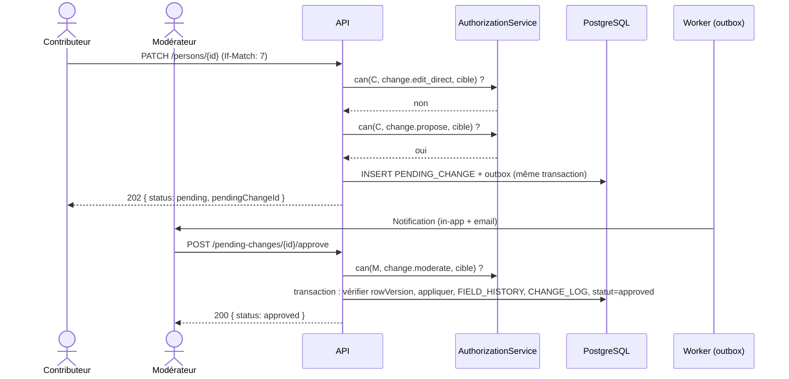
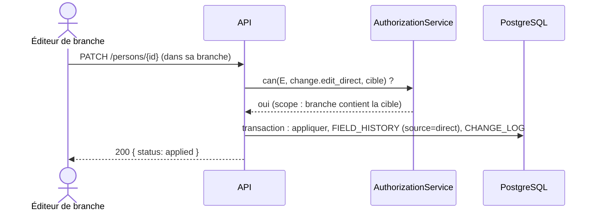

# 06 — Conception de l'API

| | |
|---|---|
| **Statut** | Brouillon v0.1 |
| **Dépend de** | 02-regles-metier (v0.5), 03-modele-domaine (v0.4), 04-architecture (v0.2), 05-securite-confidentialite (v0.2) |
| **Alimente** | 07-plan-livraison, implémentation du module `http/` de chaque module |

> Ce document fixe la **conception** de l'API REST (ADR-006). La spécification OpenAPI complète est **générée depuis le code** par le module Swagger de NestJS et publiée à `/api/v1/docs` ; ce document en est la référence de conception, et les écarts se corrigent des deux côtés.
> Légende : ✅ découle d'une règle ou décision validée · 🟡 choix de conception proposé.

---

## 1. Conventions générales

| Sujet | Convention |
|---|---|
| Base | `/api/v1`, JSON (`application/json`), encodage UTF-8. |
| Identifiants | UUID opaques (jamais séquentiels) ✅ M-04. |
| Authentification | Cookie de session `HttpOnly`, `Secure`, `SameSite=Lax` ✅ ADR-007. |
| CSRF | En-tête `X-CSRF-Token` obligatoire sur `POST`, `PUT`, `PATCH`, `DELETE` authentifiés. |
| Dates | Date généalogique = objet `{ "value": "1950-03-12", "precision": "day" }` ; `precision` ∈ `year`, `month`, `day`. Horodatages techniques en ISO 8601 UTC. 🟡 |
| Champs absents | Un champ non autorisé est **absent** de la réponse, jamais `null` ni masqué par `***` ✅ RG-VIS-09. |
| Concurrence | Chaque ressource modifiable expose `rowVersion`. Les `PATCH` et `DELETE` envoient `If-Match: <rowVersion>` ; discordance → `409` ✅ RG-MOD-11. |
| Pagination | Par curseur : `?limit=50&cursor=…` ; réponse `{ "items": [...], "nextCursor": "…" }`. `limit` max 100. 🟡 |
| Erreurs | `application/problem+json` (RFC 9457), avec `type`, `title`, `status`, `detail`, `code` (§7). |
| Limitation de débit | En-têtes `RateLimit-Limit`, `RateLimit-Remaining`, `RateLimit-Reset` ; `429` + `Retry-After`. |
| Langue | Les messages d'erreur sont en français ; les `code` sont stables et indépendants de la langue. 🟡 |
| Idempotence | Les créations acceptent `Idempotency-Key` (rejeu sûr en cas de réseau instable). 🟡 |

### 1.1 Existence cachée : 404 plutôt que 403 ✅ OS-01
Quand un demandeur n'a pas le droit de **connaître l'existence** d'une ressource (profil `private`, ressource hors visibilité), l'API répond **`404`**, pas `403`. Le `403` est réservé aux cas où l'existence est déjà connue du demandeur (par exemple modifier une ressource qu'il peut lire mais pas éditer).

### 1.2 Résultat d'une écriture : appliqué ou en attente ✅ RG-MOD-00/01/09
Toute écriture sur le contenu généalogique passe par la décision « direct ou modéré » (doc 03 §5.1), **côté serveur**. Le client ne choisit jamais.

| Cas | Statut HTTP | Corps |
|---|---|---|
| Permission d'édition directe | `200` ou `201` | `{ "status": "applied", "resource": { … } }` |
| Contributeur simple (ou hors périmètre) | **`202 Accepted`** | `{ "status": "pending", "pendingChangeId": "…" }` |
| Aucune permission | `403` ou `404` (§1.1) | problème |

---

## 2. Représentations des personnes (visibilité par projection) ✅ ADR-008

Un schéma par niveau d'accès. Le serveur choisit le schéma **à partir du demandeur** (doc 05 §4), jamais d'un paramètre.

| Schéma | Niveau | Champs possibles |
|---|---|---|
| `PersonPublic` | L0 (sans compte) | `id`, `firstNames`, `lastName`, `birthYear`*, `deathYear`, `lifeStatus`, liens de parenté (identifiants) |
| `PersonMember` | L1 (connecté non approuvé) | ceux de `PersonPublic` + champs `members_only` autorisés |
| `PersonApproved` | L2 (connecté approuvé) | ceux de `PersonMember` + `birthDate`, `birthPlace`, `deathDate`, `deathPlace`, `photoUrl` (signée), `documents[]` selon la visibilité effective |
| `PersonAdmin` | L3 (admin, co-admin) | ceux de `PersonApproved` + `visibility` par catégorie, `isDeleted`, `rowVersion`, `claimedByAccountId` |
| `PersonMasked` | tout niveau, profil non visible | `{ "id": "…", "masked": true }` ✅ RG-VIS-12 |

\* `birthYear` absent pour un **mineur vivant** hors niveau L2 ✅ RG-VIS-10.

Exemple `PersonApproved` :

```json
{
  "id": "6f3c1a4e-0b7a-4c1e-9d52-2b8f1c0a77d1",
  "firstNames": "Awa",
  "lastName": "Nkomo",
  "sex": "F",
  "lifeStatus": "living",
  "birthDate": { "value": "1984-06-02", "precision": "day" },
  "birthPlace": "Yaoundé",
  "photoUrl": "https://files.example/…?sig=…&exp=…",
  "rowVersion": 7
}
```

Exemple `PersonPublic` pour la même personne :

```json
{
  "id": "6f3c1a4e-0b7a-4c1e-9d52-2b8f1c0a77d1",
  "firstNames": "Awa",
  "lastName": "Nkomo",
  "lifeStatus": "living",
  "birthYear": 1984
}
```

---

## 3. Endpoints par module

Colonne **Permission** : code du doc 03 §4.1 ; « — » = aucune ; « public » = accessible sans compte.

### 3.1 `identity-access`

| Méthode | Chemin | Rôle de l'endpoint | Permission |
|---|---|---|---|
| POST | `/auth/login` | Ouvrir une session (limité en débit) | public |
| POST | `/auth/logout` | Fermer la session | session |
| GET | `/auth/me` | Compte courant, rôles, niveau d'accès | session |
| POST | `/auth/password/forgot` | Demander un lien de réinitialisation | public |
| POST | `/auth/password/reset` | Réinitialiser avec le jeton | public |
| POST | `/invitations` | Inviter par email ou lien (profil cible optionnel) ✅ RG-ACC-01 | `invitation.send` |
| GET | `/invitations` | Lister les invitations | admin |
| DELETE | `/invitations/{id}` | Révoquer | `invitation.send` (auteur) ou admin |
| POST | `/invitations/{token}/accept` | Créer le compte (statut `pending_approval`) | public |
| GET | `/accounts` | Lister les comptes | `account.approve` |
| POST | `/accounts/{id}/approve` | Approuver un compte | `account.approve` |
| POST | `/accounts/{id}/suspend` | Suspendre (révoque les sessions) | `account.approve` |
| POST | `/accounts/{id}/claim` | Rattacher à une `Person` ✅ RG-ACC-02 | `account.claim` |
| GET | `/roles` | Rôles et permissions | admin |
| POST | `/role-assignments` | Attribuer un rôle avec scope ✅ RG-ROL-02 | `role.assign` |
| DELETE | `/role-assignments/{id}` | Révoquer (refus si dernier admin, CHK-06) | `role.assign` |

### 3.2 `genealogy`

| Méthode | Chemin | Rôle de l'endpoint | Permission |
|---|---|---|---|
| GET | `/persons` | Recherche par nom (`?q=`, `?branchId=`) ✅ RG-ARB-01 | `person.search` |
| GET | `/persons/{id}` | Profil, schéma selon le niveau d'accès | `person.read` / public |
| POST | `/persons/duplicates/check` | Suggestions avant création ✅ RG-DUP-01 | `change.propose` |
| POST | `/persons` | Créer (direct ou proposé, §1.2) | `change.propose` / `change.edit_direct` |
| PATCH | `/persons/{id}` | Modifier des champs (direct ou proposé) | idem |
| DELETE | `/persons/{id}` | Suppression logique (direct ou proposée) | idem |
| POST | `/persons/{id}/merge` | Fusionner un doublon ✅ RG-DUP-02/03 | `person.merge` |
| PUT | `/persons/{id}/visibility` | Régler les niveaux par catégorie ✅ RG-VIS-02 | `visibility.manage` |
| POST | `/unions` | Créer une union (deux partenaires) | `change.propose` / `change.edit_direct` |
| PATCH | `/unions/{id}` | Modifier (statut, dates, lieu) | idem |
| DELETE | `/unions/{id}` | Supprimer | idem |
| POST | `/parent-links` | Créer un lien de filiation (`kind`) | idem |
| DELETE | `/parent-links/{id}` | Supprimer | idem |
| GET | `/branches` | Lister les branches | `person.read` |
| POST | `/branches` | Créer une branche (fondateur) | admin |
| GET | `/tree` | Arbre filtré (§4) ✅ RG-ARB-02 | `tree.generate` |
| GET | `/public/persons/{id}` | Profil public ✅ RG-VIS-04 | public |
| GET | `/public/persons/{id}/relatives` | Navigation de parenté publique | public |

### 3.3 `moderation` ✅ RG-MOD

| Méthode | Chemin | Rôle de l'endpoint | Permission |
|---|---|---|---|
| GET | `/pending-changes` | File (`?status=&mine=&branchId=`) | `change.moderate`, ou auteur pour `mine=true` |
| GET | `/pending-changes/{id}` | Détail : cible, valeurs courantes et proposées | idem |
| POST | `/pending-changes/{id}/approve` | Approuver (atomique, doc 03 §5.3) | `change.moderate` |
| POST | `/pending-changes/{id}/reject` | Rejeter, `reason` obligatoire ✅ RG-MOD-12 | `change.moderate` |
| POST | `/pending-changes/{id}/withdraw` | Retirer sa propre proposition | auteur |
| POST | `/pending-changes/{id}/resolve-conflict` | Trancher un conflit de version ✅ RG-MOD-03/11 | `conflict.resolve` |

### 3.4 `history`

| Méthode | Chemin | Rôle de l'endpoint | Permission |
|---|---|---|---|
| GET | `/persons/{id}/history` | Historique de champ, filtré par visibilité ✅ RG-HIS-03/04 | `history.read` |
| GET | `/history` | Journal général (`?entityType=&from=&to=`) | `history.read` |

### 3.5 `documents`

| Méthode | Chemin | Rôle de l'endpoint | Permission |
|---|---|---|---|
| PUT | `/persons/{id}/photo` | Envoyer la photo (`multipart/form-data`) ✅ RG-ENT-08 | `change.propose` / `change.edit_direct` |
| DELETE | `/persons/{id}/photo` | Retirer la photo | idem |
| POST | `/persons/{id}/documents` | Joindre un document | idem |
| POST | `/unions/{id}/documents` | Joindre un acte d'union | idem |
| GET | `/documents/{id}/download-url` | URL signée de courte durée ; accès journalisé ✅ ADR-010 | `person.read` + visibilité |
| DELETE | `/documents/{id}` | Retirer | idem |

### 3.6 `notifications` ✅ RG-NOT-01

| Méthode | Chemin | Rôle de l'endpoint | Permission |
|---|---|---|---|
| GET | `/notifications` | Lister les notifications de modération | session |
| POST | `/notifications/{id}/read` | Marquer comme lue | session |
| POST | `/notifications/read-all` | Tout marquer comme lu | session |

### 3.7 Administration

| Méthode | Chemin | Rôle de l'endpoint | Permission |
|---|---|---|---|
| POST | `/admin/persons/{id}/anonymize` | Anonymiser (corps : `confirm: true`, motif) ✅ RG-HIS-05 | admin |
| GET | `/admin/security-log` | Journal de sécurité (doc 05 §10) | admin |

---

## 4. Arbre filtré : `GET /tree` ✅ RG-ARB-02

| Paramètre | Rôle | Défaut |
|---|---|---|
| `rootId` | Personne de départ (obligatoire) | — |
| `up` | Générations en amont | `3` |
| `down` | Générations en aval | `3` |
| `branchId` | Restreindre à une branche | aucune |
| `includeSpouses` | Inclure les conjoints (unions) | `true` |
| `includeHalfSiblings` | Inclure les demi-frères et sœurs | `true` |
| `includeAdoptive` | Inclure les liens adoptifs ✅ P7 | `true` |

Plafonds de performance 🟡 : `up` et `down` bornés à **10** par requête ; le client change de `rootId` pour aller plus loin (pas de limite dans le modèle, RG-ENT-07).

Réponse : graphe plat, adapté au rendu et à la visibilité.

```json
{
  "rootId": "…",
  "nodes": [
    { "id": "…", "person": { /* schéma selon niveau */ }, "generation": 0 },
    { "id": "…", "masked": true, "generation": -1 }
  ],
  "parentLinks": [ { "id": "…", "parentId": "…", "childId": "…", "kind": "biological" } ],
  "unions": [ { "id": "…", "a": "…", "b": "…", "status": "married" } ],
  "truncated": { "up": false, "down": true }
}
```

- Un nœud non visible est un **nœud anonyme** `{ id, masked: true }` (RG-VIS-12).
- `kind` permet de rendre adoption et filiation biologique différemment ✅ RG-ENT-06.
- `truncated` indique si le plafond de générations a coupé le résultat.

---

## 5. Séquences clés

### 5.1 Proposition d'un contributeur, puis approbation



### 5.2 Édition directe par un éditeur de branche



---

## 6. Règles transverses de l'API

- **Contrôle d'objet** (IDOR) sur toute lecture ou écriture par identifiant (doc 05 §5).
- **Refus par défaut** : une route sans garde explicite répond `403`.
- **Pas de métadonnée qui fuit** : les compteurs, `Link` de pagination et résultats de recherche respectent la visibilité.
- **Validation** : liste blanche de champs ; un champ inconnu est refusé (`400`).
- **Fichiers** : `multipart/form-data`, taille maximale par type 🟡 (photo : 5 Mo, document : 10 Mo), validation du contenu et suppression EXIF côté serveur ✅ doc 05 §7.
- **URL signées** : durée de vie courte (60 secondes proposées 🟡), émises après contrôle de visibilité.
- **Journalisation** : les refus d'autorisation et les accès aux documents sont journalisés (doc 05 §10).

---

## 7. Erreurs métier

| `code` | HTTP | Cas | Règle |
|---|---|---|---|
| `validation.invalid_field` | 400 | Champ invalide ou inconnu | — |
| `auth.invalid_credentials` | 401 | Identifiants incorrects (message identique pour compte inconnu) | doc 05 §6.1 |
| `auth.csrf_missing` | 403 | Jeton CSRF absent ou invalide | doc 05 §8 |
| `access.forbidden` | 403 | Existence connue, droit insuffisant | §1.1 |
| `access.not_found` | 404 | Inexistant **ou** non visible | §1.1 |
| `concurrency.stale_version` | 409 | `rowVersion` périmée | RG-MOD-11 |
| `moderation.not_pending` | 409 | Décision sur une proposition déjà traitée | RG-MOD-04 |
| `moderation.conflict` | 409 | Cible modifiée depuis la proposition ; à trancher par l'admin | RG-MOD-03, RG-MOD-11 |
| `moderation.reason_required` | 422 | Rejet sans motif | RG-MOD-12 |
| `rule.cycle_detected` | 422 | Le lien ferait de la personne son propre ancêtre | RG-ENT-10 |
| `rule.too_many_biological_parents` | 422 | Plus de deux parents biologiques | RG-ENT-11 |
| `rule.union_same_person` | 422 | Union d'une personne avec elle-même | CHK-02 |
| `rule.duplicate_link` | 409 | Lien parent → enfant déjà existant | CHK-03 |
| `rule.living_cannot_be_private` | 422 | Une personne vivante ne peut pas se rendre privée | RG-VIS-06 |
| `rule.visibility_below_floor` | 422 | Niveau plus ouvert que le plancher autorisé | RG-VIS-04/05/10/11 |
| `rule.last_admin` | 409 | Retrait du dernier admin ou co-admin | RG-CON-02, CHK-06 |
| `rule.role_requires_sex` | 422 | Politique du rôle non satisfaite (chef de famille = homme) | RG-FAM-03, RG-ROL-07 |
| `file.type_not_allowed` | 415 | Type de fichier hors liste blanche | doc 05 §7 |
| `file.too_large` | 413 | Taille supérieure à la limite | doc 05 §7 |
| `rate.limited` | 429 | Trop de requêtes | doc 05 §8 |

---

## 8. Versionnement, génération de client et tests de contrat

- **Versionnement** : préfixe `/api/v1`. Un changement incompatible crée `/api/v2` ; le v1 reste actif pendant une période annoncée. Ajouter un champ optionnel n'est pas un changement incompatible.
- **Source de vérité** : l'OpenAPI générée par le code (ADR-006). Le client TypeScript du frontend est **généré** depuis cette spécification (`openapi-typescript` 🟡) et placé dans `packages/shared`.
- **Tests de contrat** : un test de CI échoue si la spécification générée diffère du fichier `openapi.json` versionné sans mise à jour explicite ; un outil de test à partir du schéma (par exemple Schemathesis 🟡) vérifie que les réponses respectent le contrat.
- **Tests de visibilité sur l'API** : la matrice du doc 05 §4.4 est jouée **sur chaque endpoint** qui retourne une personne (`/persons`, `/tree`, `/history`, `/notifications`, doublons).

---

## 9. Points ouverts

| # | Question | Pourquoi c'est important | Proposition par défaut |
|---|---|---|---|
| **P20** | Plafond de générations par requête d'arbre (10) et pagination des grands arbres. | Performance et taille de la réponse. | 10 générations par sens ; le client re-centre l'arbre pour aller plus loin. |
| **P21** | Tailles maximales de fichiers (photo 5 Mo, document 10 Mo) et durée des URL signées (60 s). | Compromis confort et sécurité. | Valeurs proposées ci-dessus. |
| **P22** | Format de date généalogique `{ value, precision }` : gérer aussi des dates **approximatives** (« vers 1920 », « avant 1950 ») ? | Réalisme des données anciennes. | Hors MVP ; champ `precision` extensible (`about`, `before`, `after`). |
