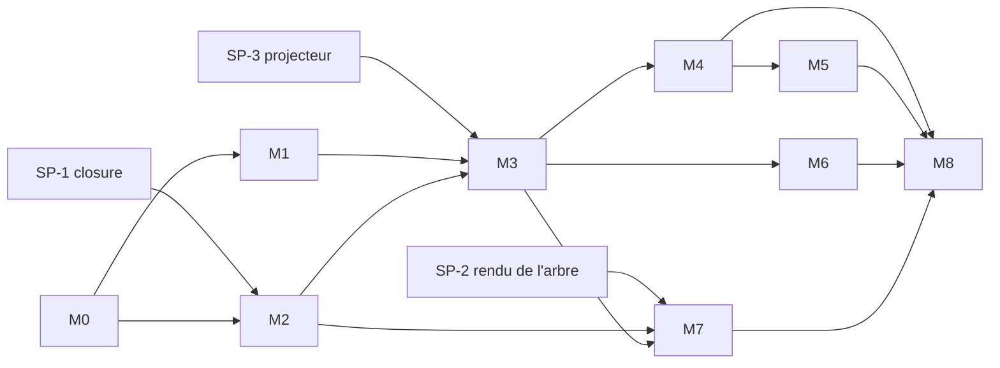

# 07 — Plan de livraison

| | |
|---|---|
| **Statut** | Brouillon v0.1 |
| **Dépend de** | 01 à 06 |
| **Alimente** | Backlog (tickets), calendrier |

> Les efforts sont en **tailles relatives** (S, M, L, XL), pas en jours : ils dépendent de ta disponibilité, qui n'est pas encore connue (voir §10). Un jalon `M` vaut environ le double d'un `S`, un `L` le double d'un `M`.
> Légende : ✅ découle d'une décision validée · 🟡 proposition à valider.

---

## 1. Principes de livraison

1. **Tranches verticales** : chaque jalon livre une fonctionnalité utilisable de bout en bout (base, API, interface minimale, tests), pas une couche technique isolée.
2. **Risque d'abord** : les deux plus gros risques (graphe et rendu de l'arbre, visibilité) sont traités par des *spikes* avant d'engager le reste (§3).
3. **Sécurité dès le premier jalon** : la matrice de visibilité (doc 05 §4.4) grandit à chaque jalon ; elle n'est pas un chantier de fin de projet.
4. **Règles traçables** : chaque ticket cite les identifiants `RG-…`, et chaque test porte le nom de la règle qu'il vérifie (ADR-013).
5. **Toujours déployable** : la branche principale est déployable à tout moment ; un jalon se termine par un déploiement sur un environnement de recette.

## 2. Définition de « prêt » et de « terminé »

**Prêt** (un ticket peut démarrer) : règles `RG-…` citées, critères d'acceptation écrits, aucune question ouverte bloquante.

**Terminé** :
- code revu (même seul : relecture à froid avec la checklist de sécurité) ;
- tests unitaires et d'intégration verts, nouveaux cas ajoutés à la matrice de visibilité si une donnée personne est exposée ;
- spécification OpenAPI régénérée et à jour (doc 06 §8) ;
- migration Prisma appliquée sur une base vierge **et** sur une base de données de test ;
- journal de sécurité alimenté pour les actions concernées (doc 05 §10) ;
- documentation (`docs/`) mise à jour si une règle ou un modèle change.

## 3. Spikes de réduction de risque

À mener **avant** M2, en boîte de temps courte (taille S chacun).

| # | Question | Livrable | Décision attendue |
|---|---|---|---|
| **SP-1** | La closure table (3 types de chemin) tient-elle les cas réels : polygamie, adoptions, mariages entre cousins, demi-fratries ? | Script de génération d'un arbre synthétique de 5 000 personnes sur 8 générations ; mesures de temps des requêtes amont/aval/lignée ; test par propriétés. | Valider doc 03 §3.1, ou ajuster `path_type`. |
| **SP-2** | Quelle bibliothèque de rendu gère polygamie, demi-fratries et liens adoptifs de façon lisible ? | Prototype de 3 mises en page sur un jeu de données types (D3 avec `d3-dag`, React Flow). | Choix de la bibliothèque d'arbre (ADR-005). |
| **SP-3** | Le projecteur de visibilité couvre-t-il toutes les surfaces sans duplication ? | Squelette de `PersonProjector` + 10 cas de la matrice. | Confirmer l'architecture de l'ADR-008. |

## 4. Jalons

| Jalon | Objectif | Taille | Dépend de |
|---|---|:-:|---|
| **M0** | Fondations du dépôt | M | — |
| **M1** | Identité et accès | L | M0 |
| **M2** | Cœur généalogique | XL | M0, SP-1 |
| **M3** | Visibilité et page publique | L | M1, M2, SP-3 |
| **M4** | Modération et historique | XL | M1, M2, M3 |
| **M5** | Branches, rôles scopés et succession | L | M2, M4 |
| **M6** | Photos et documents | M | M3 |
| **M7** | Recherche, doublons et arbre personnalisé | L | M2, M3, SP-2 |
| **M8** | Durcissement, anonymisation et mise en production | L | tous |

### M0 — Fondations du dépôt (M)
- **Livrables** : monorepo (`apps/api`, `apps/web`, `packages/shared`) ✅ ADR-002/005 ; `docker-compose` (API, PostgreSQL, MinIO) ; CI GitHub Actions (lint, tests, build) ; schéma Prisma de base et première migration ; linter d'architecture (dépendances entre modules, doc 04 §3) ; configuration des environnements et des secrets ; page « santé » de l'API.
- **Sortie** : un `docker compose up` démarre tout ; la CI passe sur une branche vide ; le test d'architecture échoue si un module en importe un autre interdit.

### M1 — Identité et accès (L)
- **Règles** : RG-ACC-01..03, RG-ROL-01..04, RG-CON-01..03 ; doc 05 §5, §6.
- **Livrables** : comptes, sessions (Argon2id, cookie, CSRF), invitations à jeton haché, approbation de compte, `AuthorizationService`, rôles et permissions en base (seed du doc 03 §4), attributions scopées, journal de sécurité, création du premier admin et du co-admin (RG-CON-03), interface de connexion et d'administration minimale.
- **Sortie** : un invité devient un compte approuvé ; une route sans garde est refusée par défaut (S-03) ; impossible de retirer le dernier admin (CHK-06).

### M2 — Cœur généalogique (XL)
- **Règles** : RG-ENT-01..12, RG-ARB-02.
- **Livrables** : `PERSON`, `PERSON_UNION`, `PARENT_LINK`, `PERSON_CLOSURE` (3 types de chemin) maintenue dans la transaction ; contraintes CHK-01..07 ; **écriture directe par l'admin uniquement** à ce stade (la modération arrive en M4) ; `GET /tree` avec filtres ; interface : formulaire de fiche, vue de l'arbre (bibliothèque choisie en SP-2).
- **Sortie** : un arbre de 5 générations avec polygamie et adoptions est saisi sans contournement ✅ critère du cadrage ; test par propriétés de la closure vert ; requêtes de graphe sous le seuil mesuré en SP-1.

### M3 — Visibilité et page publique (L)
- **Règles** : RG-VIS-01..12 ; doc 05 §4.
- **Livrables** : `PERSON_VISIBILITY`, calcul de la visibilité effective, `PersonProjector` et schémas `PersonPublic/Member/Approved/Admin/Masked` ✅ doc 06 §2 ; statut de vie explicite ; protection des mineurs ; nœud anonyme ; endpoints publics (`/public/…`) avec `noindex` et limitation de débit ; **matrice de tests de visibilité complète** sur `/persons`, `/tree`.
- **Sortie** : ✅ critère du cadrage : **aucune donnée détaillée d'une personne vivante n'est accessible sans compte approuvé**, vérifié par la matrice en CI.

### M4 — Modération et historique (XL)
- **Règles** : RG-MOD-00..13, RG-HIS-01..04, RG-NOT-01 ✅ modération complète dans le MVP.
- **Livrables** : `PENDING_CHANGE` ; décision direct/proposé (`202` vs `200/201`) ; approuver, rejeter (motif), retirer, résolution de conflit ; `FIELD_HISTORY` et `CHANGE_LOG` en ajout seul (droits SQL, ADR-012) ; écriture atomique de l'approbation ; notifications in-app et email via outbox + pg-boss (ADR-009) ; interface : file de modération, détail avec valeurs courante et proposée, historique de fiche.
- **Sortie** : ✅ critère du cadrage : une modification traverse le cycle complet *soumission → notification → décision → application → historique* ; test end-to-end vert ; un `UPDATE` sur l'historique est refusé par la base (S-08).

### M5 — Branches, rôles scopés et succession (L)
- **Règles** : RG-FAM-01..07, RG-ROL-02/03/07, RG-MOD-09.
- **Livrables** : `BRANCH`, `HOUSE`, calcul du scope par chemin `paternal` ; rôles `branch_editor` et `coeditor` ; politiques `ROLE_POLICY` (chef = homme) ; service de succession : première épouse éligible, sinon fille aînée, sinon désignation admin ; attributions **provisoires** signalées ; interface d'attribution des rôles.
- **Sortie** : la branche d'un éditeur borne ses droits d'édition directe, et une action hors scope devient une proposition modérée ; tests de succession couvrant polygamie et dates manquantes.

### M6 — Photos et documents (M)
- **Règles** : RG-ENT-08/09 ; doc 05 §7.
- **Livrables** : stockage objet privé, URL signées, validation par contenu, suppression EXIF, re-encodage, vignettes ; documents rattachés à une personne ou à une union ; accès aux documents journalisé.
- **Sortie** : un fichier hors liste blanche est refusé ; aucune URL de fichier n'est accessible sans contrôle de visibilité ; EXIF absent des fichiers servis (S-07).

### M7 — Recherche, doublons et arbre personnalisé (L)
- **Règles** : RG-ARB-01/02, RG-DUP-01..03.
- **Livrables** : recherche par nom (soumise à la visibilité) ; suggestions de doublons (`pg_trgm`, `unaccent`, score composite, ADR-011) ; fusion par l'admin, fiches archivées (P5) ; interface d'arbre personnalisé avec tous les filtres.
- **Sortie** : un doublon probable est signalé avant création ; la fusion conserve tous les liens et est tracée ; la recherche respecte la matrice de visibilité.

### M8 — Durcissement, anonymisation et mise en production (L)
- **Règles** : RG-HIS-05 ; doc 05 §9 à §12.
- **Livrables** : procédure d'**anonymisation** avec rôle SQL d'administration ; sauvegardes chiffrées et **test de restauration** ; revue de sécurité sur la checklist S-01..S-13 ; en-têtes de sécurité et CSP ; alertes de base ; procédure d'urgence ; déploiement en production ; saisie des données de départ.
- **Sortie** : toutes les lignes de la checklist du doc 05 §12 sont vérifiées ; la restauration est démontrée ; l'anonymisation est testée sur données de test ; au moins un co-admin désigné.

---

## 5. Chemin critique et parallélisation

- **Chemin critique** : M0 → M2 → M3 → M4 → M5 → M8. Ce sont les jalons de plus grand risque et de plus grande taille.
- **Parallélisable** si plusieurs personnes contribuent : M1 et M2 (après M0) ; M6 et M7 (après M3).
- **Livraison incrémentale** : après M4, le cœur de valeur est utilisable (arbre, visibilité, modération). M5 à M7 enrichissent, M8 prépare la production.

## 6. Couverture des règles par jalon

| Groupe de règles | Jalon principal |
|---|---|
| RG-ENT (entités, structure) | M2 |
| RG-VIS (visibilité) | M3 |
| RG-ROL, RG-ACC, RG-CON | M1 (rôles de base), M5 (rôles scopés) |
| RG-FAM (chefs, succession) | M5 |
| RG-MOD (modération) | M4 |
| RG-HIS (historique, anonymisation) | M4 (HIS-01..04), M8 (HIS-05) |
| RG-DUP (doublons, fusion) | M7 |
| RG-ARB (recherche, arbre) | M2 (arbre), M7 (recherche, interface) |
| RG-NOT (notifications) | M4 (NOT-01) ; NOT-02..05 hors MVP ✅ |

## 7. Stratégie de tests et de qualité par jalon

| Niveau | Contenu | Introduit en |
|---|---|---|
| Unitaires du domaine | Règles pures : succession, scope, décision direct/modéré, visibilité | M1, enrichi à chaque jalon |
| Intégration (PostgreSQL jetable) | Transactions, contraintes, closure, droits SQL | M2 |
| Propriétés | Closure incrémentale = closure recalculée ; absence de cycle | M2 |
| Matrice de visibilité | L0..L3 × catégorie × statut de vie × réglage ; sur chaque surface | M3, étendue à M4, M7 |
| Contrat API | OpenAPI générée = fichier versionné ; tests à partir du schéma | M1, étendu à chaque endpoint |
| End-to-end | Invitation → proposition → notification → approbation → historique | M4 |
| Sécurité | Checklist S-01..S-13 ; analyse des dépendances ; scan de l'application | M8 (continu dès M0 pour les dépendances) |
| Restauration | Restauration d'une sauvegarde sur un environnement vierge | M8 |

## 8. Environnements et déploiement 🟡

| Environnement | Usage | Données |
|---|---|---|
| Local | Développement (`docker compose`) | Jeux de données synthétiques |
| Recette | Démonstration à chaque fin de jalon | Données synthétiques ; aucune donnée réelle de personne vivante |
| Production | Famille | Données réelles |

Règle : **aucune donnée réelle hors production**, ni dans les jeux de test, ni dans les journaux, ni dans les captures d'écran partagées.

## 9. Risques de livraison

| # | Risque | Probabilité | Impact | Mitigation |
|---|---|:-:|:-:|---|
| RL-1 | Rendu de l'arbre illisible pour polygamie et adoption (SP-2). | Élevée | Élevé | Spike précoce ; plan B : vue en liste hiérarchique en attendant. |
| RL-2 | Complexité de la closure et du recalcul quand `sex` ou un lien change. | Moyenne | Élevé | SP-1 ; test par propriétés ; recalcul complet exposé en commande d'administration. |
| RL-3 | Règles de succession qui évoluent (P8, P14 ouverts). | Moyenne | Moyen | Politiques en base (`ROLE_POLICY`) ; M5 placé tard dans le chemin critique. |
| RL-4 | Fuite de visibilité par une nouvelle surface oubliée. | Moyenne | Très élevé | Matrice étendue à chaque endpoint ; revue obligatoire d'un nouvel endpoint exposant une personne. |
| RL-5 | Saisie initiale des données lourde et sans outil d'import. | Élevée | Moyen | Prévoir l'import (GEDCOM ou feuille de calcul) en évolution ; interface de saisie rapide dès M2. |
| RL-6 | Disponibilité limitée du porteur du projet. | Moyenne | Élevé | Jalons courts livrables seuls ; chemin critique minimal ; revoir les tailles selon la disponibilité réelle. |
| RL-7 | Dérive de périmètre au-delà du MVP. | Moyenne | Moyen | Le cadrage (doc 01 §5.2) fait foi ; toute nouveauté passe par un arbitrage explicite. |

## 10. Hypothèses et questions

**Hypothèses** : développement par une personne (tâches parallélisables seulement si d'autres contribuent) ; hébergement sur un petit serveur ou une plateforme managée (ADR-014) ; pas d'import de données existantes dans le MVP.

| # | Question | Pourquoi c'est important | Proposition par défaut |
|---|---|---|---|
| **P23** | Quelle est ta **disponibilité hebdomadaire** et as-tu une **échéance** (cérémonie, réunion de famille) ? | Convertit les tailles en calendrier et fixe l'ordre des jalons. | Planifier sans échéance ; livrer M0 à M4 d'abord. |
| **P24** | Y a-t-il des **données existantes** à importer (arbre papier, tableur, GEDCOM) ? | Détermine si l'import entre dans le MVP. | Saisie manuelle au MVP ; import en évolution. |
| **P25** | Qui d'autre contribue (développeurs, testeurs) ? | Permet de paralléliser M1/M2 et M6/M7. | Une seule personne. |

## 11. Backlog hors MVP

Reportés (doc 01 §5.2) : export PDF, image et impression de l'arbre ; notifications d'anniversaires, de dates commémoratives, de branche et de fiche modifiée ; élection du chef de famille par les membres ; double authentification (TOTP) ; lien de partage public révocable (P18) ; dates approximatives (P22) ; import GEDCOM.
