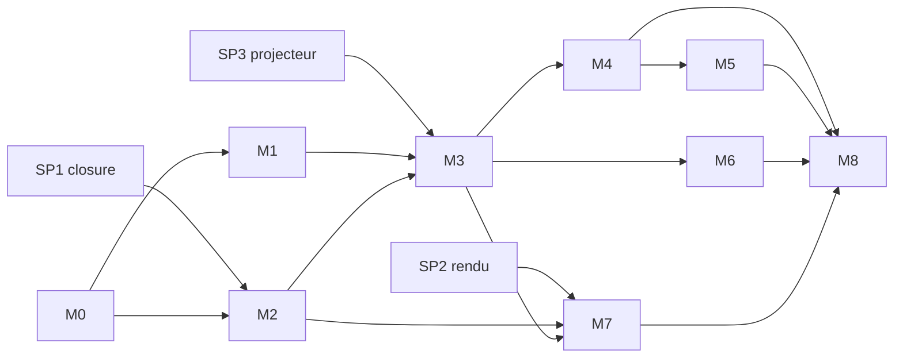

# 02 — Feuille de route

| | |
|---|---|
| **Source** | `docs/07-plan-livraison.md` (v0.1) ; décomposition en sprints, missions et tâches par l'architecte |
| **Statut des tâches** | jamais ici : voir `01-etat-des-lieux.md` (bloc AUTO) ou `node pilotage/outils/pilotage.mjs status` |

> Ce fichier décrit la **structure** du plan. Il ne contient aucun statut, pour ne pas dériver. Les tailles sont relatives (S, M, L, XL), pas des durées : disponibilité connue = 4 h par jour sans échéance (P23), à convertir en calendrier quand les premiers jalons auront été mesurés.

## Vocabulaire

| Niveau | Définition | Identifiant |
|---|---|---|
| **Jalon** | Livraison de valeur utilisable de bout en bout, terminée par une validation et un déploiement de recette (doc 07). Les spikes `SPn` sont des jalons courts de réduction de risque. | `M2`, `SP1` |
| **Sprint** | Lot cohérent de missions livrable et testable. **Sans durée calendaire.** | `M2.S1` |
| **Mission** | Ensemble de tâches visant un résultat précis. Le statut d'une mission est **dérivé** de ses tâches. | `M2.S1.A` |
| **Tâche** | Unité de travail de **taille S ou M** (une à trois sessions d'agent), avec critères d'acceptation vérifiables. Une tâche plus grosse se découpe. | `M2.S1.A1` |

Chaque dernier sprint contient une mission **Z (clôture)** : mise à jour de la documentation, déploiement de recette, validation du jalon.

## Jalons

| Jalon | Titre | Taille | Dépend de | Sprints | Missions | Tâches | Fichier |
|---|---|:-:|---|--:|--:|--:|---|
| **M0** | Fondations du dépôt | M | — | 2 | 8 | 26 | [jalons/M0-fondations.md](./jalons/M0-fondations.md) |
| **SP1** | Spike : closure table | S | — | 1 | 3 | 6 | [jalons/SP1-spike-closure.md](./jalons/SP1-spike-closure.md) |
| **SP2** | Spike : rendu de l'arbre | S | M0 | 1 | 3 | 6 | [jalons/SP2-spike-rendu-arbre.md](./jalons/SP2-spike-rendu-arbre.md) |
| **SP3** | Spike : projecteur de visibilité | S | M0 | 1 | 3 | 4 | [jalons/SP3-spike-projecteur.md](./jalons/SP3-spike-projecteur.md) |
| **M1** | Identité et accès | L | M0 | 3 | 9 | 29 | [jalons/M1-identite-acces.md](./jalons/M1-identite-acces.md) |
| **M2** | Cœur généalogique | XL | M0, SP1 | 3 | 8 | 23 | [jalons/M2-coeur-genealogique.md](./jalons/M2-coeur-genealogique.md) |
| **M3** | Visibilité et page publique | L | M1, M2, SP3 | 3 | 7 | 20 | [jalons/M3-visibilite-page-publique.md](./jalons/M3-visibilite-page-publique.md) |
| **M4** | Modération et historique | XL | M1, M2, M3 | 4 | 7 | 21 | [jalons/M4-moderation-historique.md](./jalons/M4-moderation-historique.md) |
| **M5** | Branches, rôles scopés et succession | L | M2, M4 | 4 | 6 | 19 | [jalons/M5-branches-succession.md](./jalons/M5-branches-succession.md) |
| **M6** | Photos et documents | M | M3 | 3 | 4 | 14 | [jalons/M6-photos-documents.md](./jalons/M6-photos-documents.md) |
| **M7** | Recherche, doublons et arbre personnalisé | L | M2, M3, SP2 | 3 | 5 | 14 | [jalons/M7-recherche-doublons-arbre.md](./jalons/M7-recherche-doublons-arbre.md) |
| **M8** | Durcissement, anonymisation et mise en production | L | M1, M2, M3, M4, M5, M6, M7 | 3 | 4 | 21 | [jalons/M8-durcissement-production.md](./jalons/M8-durcissement-production.md) |

## Dépendances

- Les dépendances de **jalon** sont lues dans `- dépend_jalons:` de chaque fichier ; un jalon est terminé quand toutes ses tâches sont `DONE` ou `SKIPPED`.
- Les dépendances de **tâche** (`dépend:`) sont plus fines et permettent le travail en parallèle (par exemple M2.S1 démarre pendant M1).
- **Chemin critique** : M0 → M2 → M3 → M4 → M5 → M8.
- **Cœur de valeur utilisable après M4** ; M5 à M7 enrichissent ; M8 prépare la production.

## Spikes rattachés

- `SP1` avant M2 (closure) · `SP2` avant M2.S3.B1 et M7 (rendu) · `SP3` avant M3 (projecteur).
